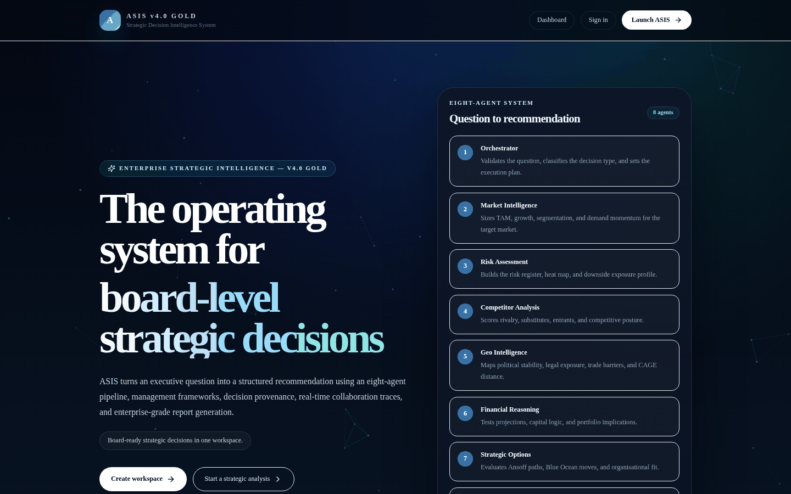
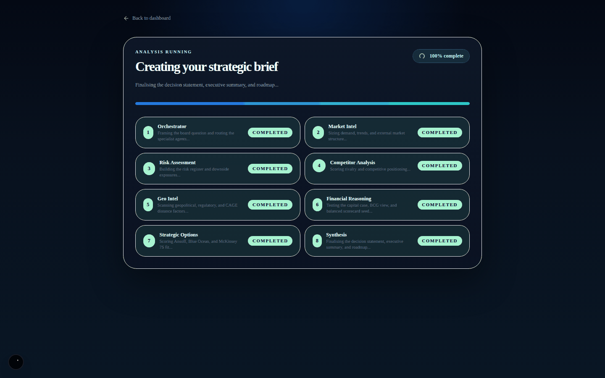
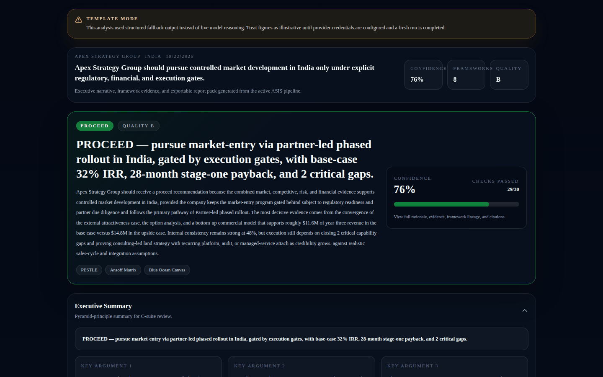
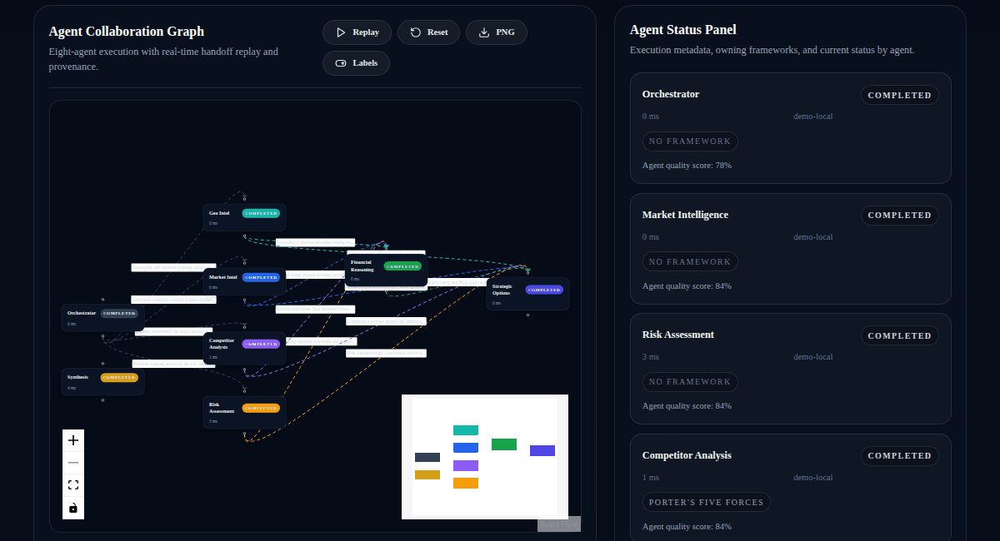
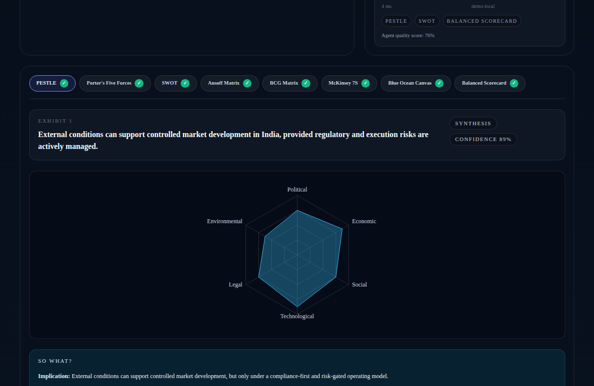
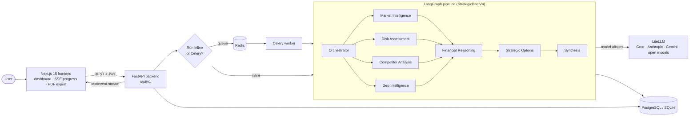

# ASIS – Strategic Intelligence Platform

**Ask a board-level strategy question; an 8-agent LangGraph pipeline returns a framework-grounded, cited decision brief — streamed live to a Next.js dashboard.**

[](https://github.com/Akshatb848/Strategic-Consultant/actions/workflows/ci.yml)
[](https://github.com/Akshatb848/Strategic-Consultant/actions/workflows/tests.yml)
[](LICENSE)


<p align="center">
  
</p>

> **About the screenshots.** Every image below was captured by running this repository locally (FastAPI backend + Next.js frontend) and driving it headlessly with Playwright. No LLM API keys were configured, so the backend ran in **demo mode** (`ASIS_DEMO_MODE=true`): the agents return structured fallback output and the UI says so with a *Template mode* banner. The figures in the brief are illustrative placeholders, not live model reasoning.

| Live agent progress (SSE) | Decision brief (demo mode) |
|---|---|
|  |  |
| **Agent collaboration graph** | **Framework exhibits** |
|  |  |

---

## What it does

ASIS (Autonomous Strategic Intelligence System) takes a strategic question plus company context — e.g. *"Should Apex Strategy Group enter the Indian fintech market through a phased partnership?"* — and runs it through eight specialised agents. The output is a validated `StrategicBriefV4`: a decision statement (PROCEED / CONDITIONAL / DO NOT PROCEED style), confidence, executive summary, eight management-framework exhibits, an agent-collaboration trace, an implementation roadmap and an exportable PDF report.

## Key features

- **8-agent LangGraph pipeline** — Orchestrator → four parallel specialists (Market Intelligence, Risk Assessment, Competitor Analysis, Geo Intelligence) → Financial Reasoning → Strategic Options → Synthesis.
- **Framework-grounded output** — PESTLE, Porter's Five Forces, SWOT, Ansoff Matrix, BCG Matrix, McKinsey 7S, Blue Ocean Canvas and Balanced Scorecard, each with citations/provenance.
- **Live progress over Server-Sent Events** — `GET /api/v1/analysis/{id}/events` streams per-agent status to the dashboard.
- **Agent collaboration graph** — typed cross-agent handoffs recorded in shared state and rendered as a replayable graph.
- **Provider-agnostic LLM layer** — all model calls go through LiteLLM aliases (Groq, Anthropic, Vertex AI Gemini and OpenAI-compatible open models are configured), with timeouts, retry back-off and an explicit demo/fallback mode.
- **Quality & evaluation** — quality grading and a deterministic heuristic evaluation module (`asis/backend/asis/backend/evaluation`).
- **Production plumbing** — JWT auth with refresh tokens (plus Google/GitHub OAuth routes), SQLAlchemy + Alembic, Celery/Redis workers or inline execution, rate limiting (slowapi), structured logging (structlog), optional Langfuse tracing.
- **Deployable** — Dockerfiles and Docker Compose, Terraform for GCP (Cloud Run, Cloud SQL, Memorystore, Secret Manager, Artifact Registry), Cloud Build configs, and a single-VM GCP free-tier path.
- **Automation hooks** — n8n workflow exports for scheduled briefs, webhooks, report delivery and alert monitoring.

## Architecture



The shared graph state carries `framework_outputs`, `agent_collaboration_trace`, `decision_statement` / `decision_confidence` / `decision_rationale` and `framework_citations`. Synthesis validates everything into `StrategicBriefV4`.

## Tech stack

| Layer | Technology |
|---|---|
| Agents / orchestration | LangGraph, LiteLLM, Groq / Anthropic / Vertex AI / OpenAI-compatible models |
| Backend | Python 3.11, FastAPI, Pydantic v2, SQLAlchemy 2, Alembic, Celery, Redis, structlog, slowapi, Langfuse (optional) |
| Frontend | Next.js 15 (App Router), React 18, TypeScript, Tailwind CSS, React Flow (collaboration graph), Recharts, Framer Motion, Puppeteer (PDF), Jest + Testing Library |
| Data | PostgreSQL (prod), SQLite (local/demo), Redis, Qdrant (in Compose) |
| Infra / DevOps | Docker, Docker Compose, Terraform (GCP), Cloud Build, GitHub Actions, n8n |

## Quick start

### Prerequisites

Python 3.11, Node 20, and (optionally) Docker. LLM keys are **optional** for a first run — demo mode works without them.

### 1. Configure environment

```bash
cp .env.example .env
```

For a zero-key local run, set at least:

```dotenv
ASIS_DEMO_MODE=true            # structured fallback output, clearly labelled in the UI
RUN_ANALYSES_INLINE=true       # no Celery/Redis needed
DATABASE_URL=sqlite:///./asis_local.db
JWT_SECRET=<any random string of 32+ characters>
FRONTEND_URL=http://localhost:3001
ALLOWED_ORIGINS=http://localhost:3001
NEXT_PUBLIC_API_URL=http://localhost:8000
```

For live reasoning, set `ASIS_DEMO_MODE=false` and provide `GROQ_API_KEY` (and/or the LiteLLM provider keys). Every variable is documented in [`.env.example`](.env.example); the GCP free-tier variant is in [`.env.gcp.example`](.env.gcp.example).

### 2. Run locally

```bash
# Backend (http://localhost:8000)
cd asis/backend
python -m venv .venv && source .venv/bin/activate
pip install -r requirements.txt
uvicorn asis.backend.main:app --reload --port 8000

# Frontend (http://localhost:3001) — in a second terminal
cd asis/frontend
npm ci
npm run dev
```

Open http://localhost:3001, register an account, and start an analysis from **New analysis**.

### 3. Or run the full stack with Docker

```bash
docker compose up --build
```

This starts the frontend, backend, Celery worker, LiteLLM proxy, PostgreSQL, Redis, Qdrant and Langfuse. See [`docker-compose.prod.yml`](docker-compose.prod.yml) and [`docker-compose.gcp-free.yml`](docker-compose.gcp-free.yml) for deployment variants.

## Testing

```bash
# Backend
cd asis/backend
pytest tests -q

# Frontend
cd asis/frontend
npm run type-check   # runs `next build`
npm run test:ci      # Jest component tests
```

Tests marked `requires_groq` make live LLM calls or assert that credentials are loaded; they are **skipped automatically when `GROQ_API_KEY` is not set**. In GitHub Actions the key is provided as a repository secret, so CI runs the full suite. CI also runs a dependency audit (pip-audit, npm audit) and an Alembic migration-head check.

## Project structure

```
.
├── asis/
│   ├── backend/              # FastAPI + LangGraph service (canonical)
│   │   ├── asis/backend/
│   │   │   ├── agents/       # orchestrator, market_intel, risk_assessment, competitor_analysis,
│   │   │   │                 # geo_intel, financial_reasoning, strategic_options, synthesis, llm_proxy
│   │   │   ├── graph/        # LangGraph pipeline + shared state
│   │   │   ├── api/          # REST + SSE routes
│   │   │   ├── evaluation/   # heuristic scoring & reports
│   │   │   ├── db/ schemas/ memory/ quality/ tasks/ config/
│   │   │   └── main.py
│   │   ├── tests/            # pytest suite
│   │   └── Dockerfile
│   ├── frontend/             # Next.js 15 app (dashboard, analysis, reports)
│   ├── infra/                # Terraform (GCP) + Cloud Build
│   └── n8n/workflows/        # automation exports
├── docs/                     # SRS, LLM hardening notes, GCP free-tier guide, screenshots
├── litellm_config.yaml       # model alias routing
├── docker-compose*.yml
├── .github/workflows/        # CI, tests, deploy
├── src/, frontend/           # legacy TypeScript prototype (reference only)
└── *.md                      # setup guides and engineering reports
```

## API Reference

### Auth

- `POST /api/v1/auth/register`
- `POST /api/v1/auth/login`
- `GET /api/v1/auth/me`
- `POST /api/v1/auth/refresh`
- `POST /api/v1/auth/logout`
- `GET /api/v1/auth/google`
- `GET /api/v1/auth/google/callback`
- `GET /api/v1/auth/github`
- `GET /api/v1/auth/github/callback`

### Analysis

- `POST /api/v1/analysis`
- `GET /api/v1/analysis`
- `GET /api/v1/analysis/{id}`
- `GET /api/v1/analysis/{id}/events`

### Reports

- `GET /api/v1/reports`
- `GET /api/v1/reports/{id}`
- `GET /api/v1/reports/{id}/evaluation`
- `GET /api/v1/reports/{analysis_id}/frameworks`
- `GET /api/v1/reports/{analysis_id}/collaboration`
- `GET /api/v1/reports/{analysis_id}/decision`
- `POST /api/v1/reports/{analysis_id}/pdf`
- `GET /api/v1/reports/{analysis_id}/pdf/status`
- `DELETE /api/v1/reports/{id}`

### Memory

- `GET /api/v1/memory`
- `DELETE /api/v1/memory`

### System

- `GET /v1/health`
- `GET /v1/metrics`

## CI/CD

| Workflow | Trigger | What it does |
|---|---|---|
| [`ci.yml`](.github/workflows/ci.yml) | PRs, pushes | Backend pytest, frontend build/type-check + Jest, dependency audit, Alembic check |
| [`tests.yml`](.github/workflows/tests.yml) | PRs/pushes to `main`/`develop` | Backend tests on Python 3.11 & 3.12 (PostgreSQL service container), flake8, quality checks |
| [`deploy-gcp-free.yml`](.github/workflows/deploy-gcp-free.yml) | push to `main` | Builds images and deploys to a single GCP free-tier VM |
| [`deploy.yml`](.github/workflows/deploy.yml) | manual | Cloud Build → Cloud Run (managed GCP stack) |
| [`production-verify.yml`](.github/workflows/production-verify.yml) | schedule / manual | Verifies the Groq key/connectivity and production LLM configuration |

Deployment details: [`docs/gcp-free-tier.md`](docs/gcp-free-tier.md), [`asis/infra/terraform`](asis/infra/terraform), [`asis/infra/cloudbuild`](asis/infra/cloudbuild). LLM reliability notes: [`docs/LLM_HARDENING.md`](docs/LLM_HARDENING.md).

## Limitations & roadmap

- **Demo mode is not analysis.** Without provider keys the pipeline returns structured template output; the UI labels it, but numbers in such briefs are placeholders.
- **No live data retrieval yet.** Agents reason from the question, company context and model knowledge. `TAVILY_API_KEY` / `NEWSAPI_KEY` settings exist, but no search/news client is wired in; the tool-call metadata shown in demo/fallback output (e.g. Geo Intelligence) is illustrative.
- **Live-LLM tests depend on a secret.** Tests marked `requires_groq` only run where `GROQ_API_KEY` is available (CI, or a developer with a key).
- **Legacy code in the root** (`src/`, `frontend/`, root `package.json`) is an earlier TypeScript prototype kept for reference; the maintained application lives under `asis/`.
- Roadmap ideas: retrieval over curated market/regulatory sources, human-in-the-loop review between agents, cost/latency dashboards per run, and broader end-to-end tests of the SSE flow.

## License

[MIT](LICENSE) © 2026 Akshat Banga

## Author

**Akshat Banga** — AI Generalist · AI transformation  
GitHub: [@Akshatb848](https://github.com/Akshatb848)
